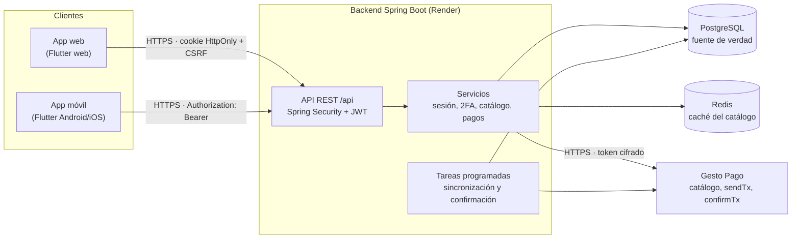
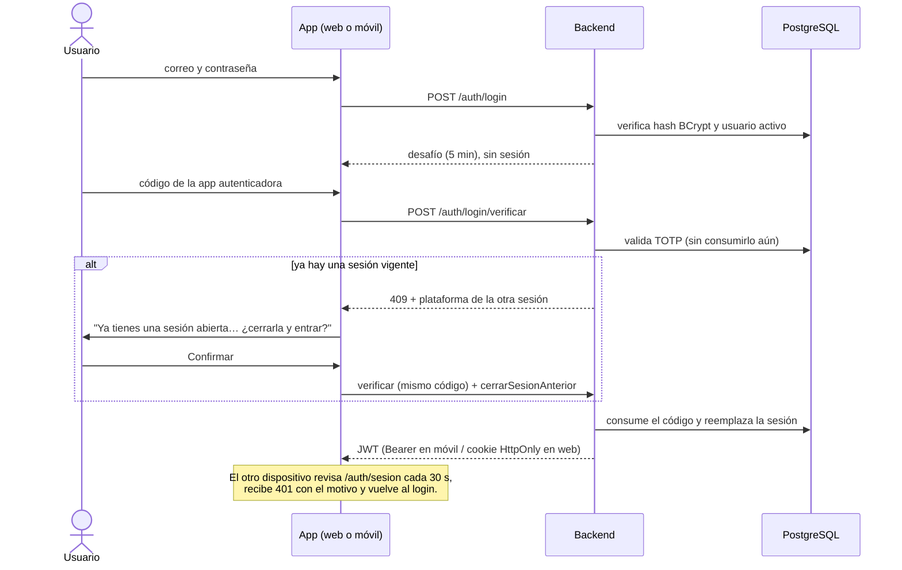

# Gestopago — Comercio digital web y móvil

Ecosistema de comercio digital formado por una **aplicación web** y una **aplicación móvil**, ambas
hechas en Flutter, que comparten usuarios y consumen el mismo backend REST (Spring Boot) integrado con
los servicios de **Gesto Pago**. Permite iniciar sesión con doble factor, consultar el catálogo real del
proveedor, comprar servicios, recargas y tarjetas de regalo, y consultar el historial de compras
exitosas, con una sola sesión activa por usuario entre ambas plataformas.

> Proyecto académico (10.º cuatrimestre). Las cuentas de los clientes son internas (no bancarias); las
> compras se envían de verdad a Gesto Pago.

## Contenido

1. [Funcionalidades](#1-funcionalidades)
2. [Arquitectura](#2-arquitectura)
3. [Tecnologías](#3-tecnologías)
4. [Ejecución local](#4-ejecución-local)
5. [Integración: contrato de la API](#5-integración-contrato-de-la-api)
6. [Endpoints utilizados](#6-endpoints-utilizados)
7. [Funcionamiento de los flujos principales](#7-funcionamiento-de-los-flujos-principales)
8. [Seguridad y protección de información](#8-seguridad-y-protección-de-información)
9. [Manejo de errores](#9-manejo-de-errores)
10. [Base de datos y migraciones](#10-base-de-datos-y-migraciones)
11. [Pruebas](#11-pruebas)
12. [Despliegue y configuración](#12-despliegue-y-configuración)
13. [Documentación complementaria](#13-documentación-complementaria)
14. [Limitaciones conocidas](#14-limitaciones-conocidas)

---

## 1. Funcionalidades

La web y el móvil son **la misma aplicación Flutter** compilada para navegador y para Android/iOS, por lo
que ofrecen las mismas operaciones con la misma información. Ninguna regla de negocio vive en la app:
todas se validan en el backend.

| Módulo | Qué puede hacer el usuario |
| --- | --- |
| **Autenticación** | Iniciar sesión con correo y contraseña; completar el **segundo factor (TOTP)** con una app autenticadora; usar las mismas credenciales en web y móvil; cerrar sesión. |
| **Sesión única** | Si ya hay una sesión abierta en otro dispositivo, el sistema **avisa y pide confirmación** antes de cerrarla. El dispositivo anterior regresa solo al login con el motivo ("iniciaste sesión en la plataforma web"). |
| **Catálogo** | Consultar los productos reales de Gesto Pago agrupados por servicio y **categoría**; buscar (sin importar acentos); ver nombre, descripción, precio, imagen (logo del servicio o, si no tiene, sus iniciales; con ícono de categoría) y **disponibilidad** para compra. |
| **Compra** | Elegir un producto, revisar sus datos y precio, **confirmar** y autorizar con el código TOTP. El resultado se distingue claramente: **compra exitosa, rechazada, pendiente o error de comunicación**, con confirmación visual. |
| **Historial** | Consultar solo las **compras exitosas**: fecha y hora, producto, importe, referencia de la transacción y detalle (autorización, folio, PIN oculto por seguridad). |
| **Gestión (ejecutivos)** | Registrar clientes (con su cuenta interna y usuario), buscarlos, consultar cuentas, dar de baja y conciliar pagos inciertos con doble aprobación. |

Roles: `CLIENTE` (compra y consulta lo propio) y `EJECUTIVO` (administra clientes). Un cliente nunca puede
ver ni operar datos de otro.

## 2. Arquitectura



- **Un solo backend para ambas apps.** La web envía el JWT en una cookie `HttpOnly` con protección CSRF;
  el móvil lo envía en `Authorization: Bearer`. Las dos llaman a los mismos endpoints.
- **PostgreSQL es la fuente de verdad** de usuarios, sesiones, cuentas, pagos y catálogo. Redis solo
  acelera la lectura del catálogo; si falla, el sistema sigue funcionando.
- **Gesto Pago** se consume desde el backend: la app nunca habla directo con el proveedor ni conoce sus
  credenciales.

### Capas del backend

Paquete base: `backend/src/main/java/com/proyecto/servicios`.

| Capa | Responsabilidad |
| --- | --- |
| `controller` | Contratos HTTP (`AuthController`, `ProductCatalogController`, `PagoController`, `CuentaController`, `ClienteController`, `UsuarioController`, `ConciliacionPagoController`) y manejo de errores. |
| `service` / `service/Impl` | Reglas de negocio: sesión única, 2FA, catálogo, pagos (`PagoLedger`), conciliación. Interfaz + implementación. |
| `client` | Clientes HTTP (OpenFeign) hacia Gesto Pago. |
| `repositorys`, `entity`, `specification` | Persistencia con Spring Data JPA. |
| `model`, `mapper` | DTOs de petición/respuesta y conversiones (MapStruct). Nunca exponen contraseñas, hashes ni tokens. |
| `config`, `exception`, `support` | Seguridad, CORS/CSRF, configuración y errores. |

### Estructura de la app Flutter

| Carpeta (`frontend/lib`) | Contenido |
| --- | --- |
| `screens/` | Pantallas: login, inicio, catálogo, pago, compras (historial), cuenta y gestión. |
| `services/` | Llamadas a la API (`auth_api_service`, `payment_api_service`, …). |
| `models/` | Sesión, desafío de login y reglas de presentación del catálogo (`catalog.dart`). |
| `storage/` | Sesión segura: `flutter_secure_storage` en móvil, cookie del navegador en web. |
| `widgets/`, `theme.dart` | Componentes y tokens de diseño compartidos (colores, espacios, radios, animaciones). |

### Estructura del repositorio

```
backend/    API Spring Boot: código, migraciones Flyway, pruebas y Gradle Wrapper
frontend/   Aplicación Flutter (web y móvil)
docs/       Documentación técnica detallada
```

## 3. Tecnologías

| Tecnología | Uso |
| --- | --- |
| Java 17 + Spring Boot 3.3 | API REST |
| Spring Security, JWT (jjwt), BCrypt | Autenticación, autorización y contraseñas |
| TOTP (RFC 6238) | Segundo factor en login y pagos |
| Spring Data JPA / Hibernate + PostgreSQL | Persistencia transaccional |
| Flyway | Migraciones de base de datos (V1–V24) |
| Redis | Caché del catálogo |
| OpenFeign, Jackson XML, Apache HttpClient 5 | Integración con Gesto Pago |
| MapStruct | Conversión de productos |
| Flutter 3 / Dart | App web y móvil |
| JUnit 5, Mockito, H2, `flutter_test` | Pruebas |
| Swagger / OpenAPI, Actuator | Documentación viva y salud del servicio |

## 4. Ejecución local

**Requisitos:** JDK 17+, PostgreSQL, Redis (opcional, solo para la caché), Flutter SDK y, para pagos
reales, credenciales autorizadas de Gesto Pago.

La configuración privada va en `backend/src/main/resources/application-local.properties` (ignorado por
Git) o en variables de entorno. **Nunca** se suben secretos al repositorio.

**Backend** (desde `backend/`):

```powershell
.\gradlew.bat bootRun
```

- Salud: `http://localhost:8080/actuator/health`
- Swagger: `http://localhost:8080/swagger-ui/index.html`

**App web** (desde `frontend/`):

```powershell
flutter run -d chrome --dart-define=API_BASE_URL=http://localhost:8080
```

Para la web local el backend debe permitir el origen:
`app.web-session.allowed-origins=http://localhost:[*],http://127.0.0.1:[*]`.

**App móvil** (desde `frontend/`, con emulador Android):

```powershell
flutter run --dart-define=API_BASE_URL=http://10.0.2.2:8080
```

`10.0.2.2` es la computadora vista desde el emulador; un teléfono físico usa la IP de la computadora en
la red local.

**Primer ejecutivo:** con `auth.bootstrap-executive.enabled=true`, `auth.bootstrap-executive.email` y
`auth.bootstrap-executive.password` (contraseña segura) en la configuración local, el backend crea el
primer ejecutivo al arrancar si no existe otro. Después se debe volver a `false` y retirar la contraseña.

## 5. Integración: contrato de la API

- **Base:** todos los endpoints de negocio cuelgan de `/api` y reciben/devuelven JSON.
- **Filtros en el cuerpo:** las consultas usan `POST` con filtros JSON, no parámetros en la URL.
- **Autenticación en cada petición protegida:**
  - Móvil: `Authorization: Bearer <accessToken>`.
  - Web: cookie `GP_SESSION` (HttpOnly) + encabezado `X-XSRF-TOKEN` en operaciones que modifican datos.
- **Respuesta general** (`GenericResponse`):

```json
{ "codigo": 1, "mensaje": "Texto para el usuario", "datos": { } }
```

| `codigo` | Significado |
| --- | --- |
| `1` | Éxito, con `datos`. |
| `0` | Consulta sin resultados (sin `datos`). |
| `2` | Error; `mensaje` explica qué pasó sin detalles internos. |

- **Respuesta de pagos** (`/api/pagos/autorizar`, `/consulta`, `/cancelar`), contrato propio:

```json
{ "codigo": "01", "mensaje": "Pago realizado correctamente", "datos": { "estado": "APLICADO", "...": "..." } }
```

`"01"` solo cuando la compra quedó **aplicada**; `"02"` en cualquier otro caso (se debe leer
`datos.estado`).

- **Paginación:** `{"pagina": 0, "tamanio": 20}` (máximo 100). La respuesta trae
  `{contenido, pagina, tamanio, totalElementos, totalPaginas, ultima}`.
- **Fechas:** ISO-8601 en UTC (`2026-11-15T16:32:00Z`); la app las muestra en hora local.
- **Importes:** decimales con 2 posiciones (`BigDecimal`), en MXN.

La lista completa con esquemas está en **Swagger** (`/swagger-ui/index.html`).

## 6. Endpoints utilizados

### 6.1 Resumen

| Método | Endpoint | Rol | Uso |
| --- | --- | --- | --- |
| POST | `/api/auth/login` | Público | Paso 1: contraseña → desafío 2FA |
| POST | `/api/auth/login/verificar` | Público | Paso 2: código TOTP → sesión |
| GET | `/api/auth/sesion` | Autenticado | Perfil de la sesión vigente (y revisión periódica) |
| POST | `/api/auth/logout` | Autenticado | Cerrar sesión |
| GET | `/api/auth/csrf` | Público | Token CSRF para la web |
| GET | `/api/products` | Autenticado | Catálogo de Gesto Pago |
| POST | `/api/cuentas/mias/consulta` | Cliente | Cuentas propias y saldo |
| POST | `/api/cuentas/consulta` | Cliente / Ejecutivo | Una cuenta por número (el cliente solo las suyas) |
| POST | `/api/cuentas/saldo/consulta` | Cliente / Ejecutivo | Saldo de una cuenta |
| POST | `/api/pagos/segundo-factor/estado` | Cliente | ¿Tiene autenticador activo? |
| POST | `/api/pagos/segundo-factor/preparar` | Cliente | Nuevo/cambio de autenticador (QR) |
| POST | `/api/pagos/segundo-factor/activar` | Cliente | Activa el autenticador y entrega códigos de recuperación |
| POST | `/api/pagos/preparar` | Cliente | Prepara una compra (no cobra) |
| POST | `/api/pagos/autorizar` | Cliente | Autoriza con TOTP y envía a Gesto Pago |
| POST | `/api/pagos/consulta` | Cliente | Estado y comprobante de una compra |
| POST | `/api/pagos/cancelar` | Cliente | Cancela una compra aún no enviada |
| POST | `/api/pagos/historial` | Cliente | Movimientos paginados con su estado; `filtro`: `EXITOSAS` (por omisión, solo compras confirmadas), `RECHAZADAS`, `PENDIENTES` o `TODOS` |
| POST | `/api/usuarios/consulta` | Autenticado | Perfil propio |
| PUT | `/api/usuarios/password` | Autenticado | Cambiar la contraseña propia |
| POST | `/api/clientes` | Ejecutivo | Alta de cliente (cliente + domicilio + cuenta + usuario) |
| POST | `/api/clientes/registro` | Público | Registro propio desde el login: mismos datos y validaciones; límite de intentos por IP |
| GET | `/api/catalogos/registro` | Público | Países, nacionalidades y ocupaciones para las listas del registro; el alta valida contra ellos |
| GET | `/api/clientes/mis-datos` | Cliente | Datos propios (contacto, domicilio y empleo) |
| PUT | `/api/clientes/mis-datos` | Cliente | Edita teléfonos, estado civil, domicilio, ocupación, empresa e ingreso; identidad y correo no cambian |
| POST | `/api/clientes/consulta` | Ejecutivo | Búsqueda de clientes |
| PUT | `/api/clientes` | Ejecutivo | Actualizar cliente |
| DELETE | `/api/clientes` | Ejecutivo | Baja lógica del cliente |
| POST | `/api/cuentas/activas/consulta` | Ejecutivo | Cuentas activas |
| PATCH | `/api/cuentas` | Ejecutivo | Desactivar una cuenta |
| POST | `/api/usuarios/busqueda` | Ejecutivo | Búsqueda de usuarios |
| POST | `/api/pagos/conciliacion/*` | Ejecutivo habilitado | Conciliación con doble aprobación |

### 6.2 Inicio de sesión — paso 1

`POST /api/auth/login`

```json
{ "email": "cliente@example.com", "password": "Segura123!" }
```

Validaciones: correo válido (máx. 254, sin espacios) y contraseña (máx. 72).

Respuesta `200`:

```json
{
  "codigo": 1,
  "mensaje": "Contrasena verificada. Falta el segundo factor",
  "datos": {
    "desafio": "<JWT de desafío, vence en 5 min>",
    "segundoFactorConfigurado": true,
    "venceEn": "2026-11-15T16:37:00Z"
  }
}
```

Si el usuario aún no tiene autenticador, `segundoFactorConfigurado` es `false` y `datos.configuracion`
trae `{secreto, uri}` (`otpauth://…`) para escanearlo como QR. **No crea sesión.**

| HTTP | Caso |
| --- | --- |
| 401 | Correo o contraseña incorrectos (mismo mensaje si el usuario no existe o está inactivo) |
| 429 | Demasiados intentos (`Retry-After`) |
| 400 | Datos con formato inválido |

### 6.3 Inicio de sesión — paso 2

`POST /api/auth/login/verificar` — la web agrega el encabezado `X-Auth-Mode: cookie`.

```json
{ "desafio": "<desafío del paso 1>", "codigo": "123456" }
```

Alternativas: `codigoRecuperacion` en lugar de `codigo` (cuatro grupos de 8 caracteres), y
`"cerrarSesionAnterior": true` para confirmar el cierre de otra sesión abierta.

Respuesta `200`:

```json
{
  "codigo": 1,
  "mensaje": "Inicio de sesion correcto",
  "datos": {
    "accessToken": "<JWT>",
    "tokenType": "Bearer",
    "expiresAt": "2026-11-16T00:32:00Z",
    "user": { "id": "…", "email": "cliente@example.com", "identifier": "cliente@example.com", "fullName": "Ana López", "rol": "CLIENTE" },
    "codigosRecuperacion": ["AAAAAAAA-BBBBBBBB-CCCCCCCC-DDDDDDDD", "…"]
  }
}
```

- En la web el JWT **no viaja en el cuerpo**: llega en la cookie `GP_SESSION`.
- `codigosRecuperacion` solo aparece al vincular el autenticador por primera vez.

| HTTP | Caso |
| --- | --- |
| 409 | **Ya hay una sesión abierta** en otro dispositivo. `datos: {plataforma: "WEB" \| "MOVIL", iniciadaEn}`. El código **no se consume**: se reenvía con `cerrarSesionAnterior: true`. |
| 401 | Código incorrecto, ya usado o desafío vencido |
| 429 | 5 códigos fallidos: bloqueo de 5 minutos |

### 6.4 Sesión, cierre y CSRF

- `GET /api/auth/sesion` → `datos`: perfil del usuario. Si la sesión fue reemplazada desde otro
  dispositivo responde **401** con `datos.plataforma`, y la app explica el motivo.
- `POST /api/auth/logout` → **204**. Revoca solo esa sesión y borra las cookies web.
- `GET /api/auth/csrf` → `datos: {headerName: "X-XSRF-TOKEN", token}` (solo web).

### 6.5 Catálogo

`GET /api/products` (sin cuerpo).

```json
{
  "codigo": 1,
  "mensaje": "Catalogo consultado correctamente",
  "datos": {
    "mensaje": { "codigo": "01", "texto": "…" },
    "productos": {
      "productos": [
        {
          "servicio": "Telcel", "producto": "Recarga $20",
          "idServicio": 133, "idProducto": 582, "idCatTipoServicio": 2,
          "tipoFront": 1, "precio": 20.00, "hasDigitoVerificador": false,
          "showAyuda": false, "tipoReferencia": "a", "legend": "Instrucciones del proveedor…"
        }
      ]
    }
  }
}
```

| Campo | Uso en la app |
| --- | --- |
| `servicio`, `producto` | Agrupación por servicio y nombre del producto |
| `idCatTipoServicio` | Categoría (recargas, luz/gas/TV, agua, tarjetas de regalo, …) |
| `tipoFront` | 1 = precio fijo · 2 = el cliente indica el importe · 4 = importe según el recibo · otros = no disponible en la app |
| `precio` | Solo es el precio real cuando `tipoFront` = 1 |
| `legend` | Descripción e instrucciones del proveedor |

Errores: **502** proveedor no disponible y sin copia local; **500** error procesando el catálogo. Detalle
de categorías y reglas: [docs/catalogo.md](docs/catalogo.md).

### 6.6 Compra

**1. Preparar** — `POST /api/pagos/preparar` (no cobra):

```json
{
  "solicitudId": "6f1c…-uuid generado por la app",
  "numeroCuenta": "CTA-0123456789ABCDEF0123",
  "idServicio": 133, "idProducto": 582, "tipoFront": 1,
  "monto": "20.00",
  "telefono": "5512345678"
}
```

- `telefono` (10–20 dígitos) para recargas; `referencia` (1–100) para servicios con recibo.
- `solicitudId` permite repetir la petición sin crear dos compras (idempotencia).
- Validaciones del backend: cuenta propia y activa, saldo disponible, producto vigente, precio exacto en
  `tipoFront` 1, límites configurados y que no exista otra operación igual sin resolver.

Respuesta `200` (`datos`): `pagoId`, `estado: "PREPARADO"`, `concepto`, `monto`, `comisionCliente`,
`upc` (folio), `venceEn`, `autorizacionDisponible`, `aviso`.

**2. Autorizar** — `POST /api/pagos/autorizar`:

```json
{ "pagoId": "<pagoId>", "codigo": "123456" }
```

Consume el código TOTP, **retiene** el importe y envía la venta a Gesto Pago **una sola vez**. Respuesta
con el contrato de pagos:

| `datos.estado` | Resultado en la app |
| --- | --- |
| `APLICADO` | **Compra exitosa** (`codigo: "01"`): importe, `idTransaccion`, `autorizacion`, `pin` si es tarjeta de regalo |
| `RECHAZADO` | **Compra rechazada**: no hubo cobro y la retención se libera |
| `ENVIADO` / `PENDIENTE` / `REVISION` | **Compra pendiente**: el backend confirma con Gesto Pago en segundo plano |
| `EXPIRADO` | Solicitud vencida antes de autorizar; no hubo cobro |
| Sin respuesta (red, timeout, 5xx) | **Error de comunicación**: la app solo permite consultar el estado |

**3. Consultar** — `POST /api/pagos/consulta` con `{"pagoId": "…"}` devuelve el estado actual y el
comprobante. **Cancelar** — `POST /api/pagos/cancelar` con `{"pagoId": "…"}` solo funciona en
`PREPARADO`.

| HTTP | Caso (mensaje claro para el usuario) |
| --- | --- |
| 403 | Código 2FA incorrecto o ya usado; el autenticador cambió |
| 409 | Saldo insuficiente, cuenta inactiva, límite diario, operación similar pendiente |
| 400 | Teléfono, referencia o importe inválidos |
| 429 | Demasiados intentos |
| 503 | Pagos no disponibles en este momento |

Detalle completo del flujo, estados y conciliación: [docs/payment-flow.md](docs/payment-flow.md).

### 6.7 Historial de movimientos

`POST /api/pagos/historial`

```json
{ "pagina": 0, "tamanio": 20, "filtro": "TODOS" }
```

`filtro` es opcional: `EXITOSAS` (por omisión; solo compras confirmadas por el proveedor, el historial
que pide el requisito), `RECHAZADAS`, `PENDIENTES` (enviadas sin resultado o en conciliación) o `TODOS`.
Las solicitudes preparadas que nunca se autorizaron no aparecen.

Respuesta `200` (`codigo` 1) o `codigo` 0 si no hay movimientos:

```json
{
  "codigo": 1,
  "mensaje": "Historial de compras",
  "datos": {
    "contenido": [
      {
        "pagoId": "…", "concepto": "Recarga $20", "monto": 20.00,
        "fecha": "2026-11-15T16:32:00Z",
        "idTransaccion": "812345", "autorizacion": "556677",
        "numeroCuenta": "CTA-0123456789ABCDEF0123", "estado": "APLICADO"
      }
    ],
    "pagina": 0, "tamanio": 20, "totalElementos": 1, "totalPaginas": 1, "ultima": true
  }
}
```

Solo incluye compras `APLICADO` del usuario de la sesión, de la más reciente a la más antigua. El detalle
de cada una se pide a `/api/pagos/consulta`.

### 6.8 Cuentas y usuario

- `POST /api/cuentas/mias/consulta` con `{"pagina": 0, "tamanio": 100}` → cuentas propias con
  `numeroCuenta`, `saldo`, `saldoDisponible`, `saldoRetenido`, `activa`.
- `POST /api/cuentas/saldo/consulta` con `{"numeroCuenta": "CTA-…"}` → saldo de esa cuenta (el cliente
  solo las suyas; una cuenta ajena responde 404).
- `PUT /api/usuarios/password` con
  `{"nombre", "correo", "credenciales": {"contrasenaActual", "nuevaContrasena"}}` → **204** y cierre de
  sesión. Máximo 5 intentos cada 5 minutos.

## 7. Funcionamiento de los flujos principales

### 7.1 Login con doble factor y sesión única



- Una sola fila de sesión por usuario en `user_sessions`, con su plataforma (`WEB` / `MOVIL`).
- Cada petición valida firma, vencimiento y que **esa** sesión siga vigente en PostgreSQL.
- Quien aún no tiene autenticador lo vincula en su primer login (QR); nadie entra sin segundo factor.

### 7.2 Compra

1. **Catálogo:** el usuario elige un producto y ve su precio, lo que necesita (teléfono o referencia) y
   su descripción. Si un producto no se puede comprar desde la app, aparece como *Solo consulta*.
2. **Preparar:** el backend valida todo y fija importe, destino y reglas sin cobrar.
3. **Confirmar:** el usuario revisa el resumen y autoriza con su código TOTP.
4. **Enviar:** en una transacción se consume el código y se retiene el saldo; después se envía a Gesto
   Pago una sola vez (sin reintentos automáticos).
5. **Resultado:** aplicado → se descuenta y aparece en el historial; rechazado → se libera; incierto →
   un trabajador consulta a Gesto Pago (`confirmTx`) hasta 24 h. Los casos dudosos pasan a conciliación
   humana con doble aprobación.

Si la app pierde la respuesta, nunca reintenta: muestra "No pudimos confirmar tu compra" y solo permite
consultar el estado.

### 7.3 Catálogo y sincronización

- Lectura: **Redis → PostgreSQL → Gesto Pago**. Cada nivel cubre la falla del anterior.
- Sincronización diaria (02:00, hora de México): se reemplaza el catálogo si llega **al menos el 90 %**
  de los productos guardados (entran cambios de precio y bajas normales; una respuesta cortada no borra el
  catálogo). El reemplazo es transaccional y después se actualiza Redis.

## 8. Seguridad y protección de información

| Requisito | Implementación |
| --- | --- |
| **HTTPS** | En producción (Render) todo el tráfico va por HTTPS; las cookies son `Secure`. Las llamadas a Gesto Pago exigen HTTPS. |
| **JWT** | Firmado (HMAC, llave de 32+ bytes), con emisor y vencimiento de 8 h. El desafío de login no sirve como sesión. |
| **2FA en el servidor** | TOTP (RFC 6238) validado siempre en el backend; un código no se puede reutilizar; 5 fallos = bloqueo de 5 min; códigos de recuperación de un solo uso. |
| **Sesión centralizada** | Sesión única por usuario en PostgreSQL, revisada en cada petición; logout real; expiración automática; dar de baja a un cliente o cambiar su contraseña cierra su sesión. |
| **Control de acceso** | Por rol en las URLs y en cada servicio (`@PreAuthorize`); cada consulta filtra por el dueño de la sesión. |
| **Credenciales** | Contraseñas con BCrypt; nunca se devuelven ni se registran. Contraseñas seguras obligatorias. |
| **Web** | JWT en cookie `HttpOnly` (inaccesible para JavaScript), `SameSite` y CSRF en operaciones que modifican datos; CORS solo para orígenes configurados. |
| **Móvil** | Sesión en `flutter_secure_storage` (Keystore/Keychain). |
| **Fuerza bruta** | Login: 30 intentos/min por IP y 5 cada 5 min por cuenta; cambio de contraseña: 5 cada 5 min. |
| **Datos sensibles** | Secretos TOTP, token del proveedor, payloads y evidencias de pago cifrados con AES-GCM. Cuenta enmascarada y PIN oculto en pantalla. |
| **Validación** | Bean Validation en cada petición, JSON estricto (sin booleanos o fechas ambiguas); la app también valida, pero manda el backend. |
| **Errores** | Mensajes comprensibles sin trazas, SQL, tokens ni datos del proveedor; los logs solo guardan el tipo de error. |
| **Arranque seguro** | En Render el backend no arranca sin `AUTH_JWT_SECRET`, la llave de cifrado y URLs válidas. |

Más detalle: [docs/web-session-security.md](docs/web-session-security.md),
[docs/login-2fa.md](docs/login-2fa.md), [docs/provider-token-security.md](docs/provider-token-security.md).

## 9. Manejo de errores

| HTTP | Significado | Qué hace la app |
| --- | --- | --- |
| 400 | Datos inválidos | Muestra el campo o motivo |
| 401 | Sin sesión, vencida o reemplazada | Vuelve al login (con el motivo si fue otro dispositivo) |
| 403 | Sin permiso o código 2FA incorrecto | Mensaje claro |
| 404 | No existe o no es del usuario | Mensaje genérico (no revela datos ajenos) |
| 409 | Conflicto de negocio o sesión abierta en otro dispositivo | Mensaje claro o diálogo de confirmación |
| 429 | Demasiados intentos | Pide esperar (`Retry-After`) |
| 500 / 502 / 503 | Error interno, proveedor caído o servicio no disponible | "Inténtalo más tarde"; en pagos, "consulta el estado" |

Todas las respuestas de error usan `{"codigo": 2, "mensaje": "…"}` (o `"02"` en pagos) y llevan
`Cache-Control: no-store`.

## 10. Base de datos y migraciones

Tablas principales: `clientes`, `domicilios`, `cuentas`, `app_users`, `user_sessions`,
`gestopago_products`, `gestopago_tokens`, `payment_orders`, `payment_evidence`, `payment_second_factors`
y `payment_reconciliations`.

- Migraciones con Flyway: `db/migration` (V1–V16, historial), `db/initial` (V1 consolidada para bases
  nuevas) y `db/payments` (V17–V24: pagos, TOTP, conciliación y plataforma de sesión). Se aplican solas
  al arrancar.
- **Nunca se editan migraciones ya aplicadas**; cada cambio va en una versión nueva.
- Restricciones en la base: unicidad de CURP, RFC, correo y número de cuenta; saldo y retención no
  negativos; una sola propuesta de conciliación abierta por pago.
- Detalle de tipos y longitudes: [docs/database-lengths.md](docs/database-lengths.md).

## 11. Pruebas

```powershell
# Backend (desde backend/)
.\gradlew.bat test

# App (desde frontend/)
flutter analyze
flutter test
```

- **Backend:** unas 615 pruebas (JUnit, Mockito, H2) de autenticación, 2FA, sesión única, permisos,
  pagos, retenciones, concurrencia, conciliación, catálogo y errores.
- **PostgreSQL real:** definiendo `ONBOARDING_TEST_JDBC_URL`, `ONBOARDING_TEST_DB_USER` y
  `ONBOARDING_TEST_DB_PASSWORD`, se ejecutan además las pruebas de pagos y migraciones en un schema
  temporal que se borra al terminar. Usar una base exclusiva de pruebas.
- **Flutter:** unas 118 pruebas de login 2FA, sesión única, catálogo, compra (los 4 resultados),
  historial y adaptación a pantallas.
- Las pruebas usan respuestas simuladas del proveedor; la integración real se comprueba con el recorrido
  completo de la app.

## 12. Despliegue y configuración

El backend se despliega en **Render** con el perfil `render`
(`https://gestopago-backend-vhlt.onrender.com`, salud en `/actuator/health`). Variables principales:

| Variable | Para qué |
| --- | --- |
| `SPRING_DATASOURCE_URL`, `SPRING_DATASOURCE_USERNAME`, `SPRING_DATASOURCE_PASSWORD` | PostgreSQL |
| `REDIS_URL` | Redis (caché) |
| `AUTH_JWT_SECRET` | Firma de JWT (32+ bytes) |
| `GESTOPAGO_TOKEN_STORAGE_KEY` | Llave AES de 32 bytes (Base64) para secretos TOTP y token del proveedor. **No cambiarla**; para rotar usar `GESTOPAGO_TOKEN_PREVIOUS_STORAGE_KEY` |
| `GESTOPAGO_AUTH_ENABLED`, `GESTOPAGO_AUTH_ID_DISTRIBUIDOR`, `GESTOPAGO_AUTH_CODIGO_DISPOSITIVO`, `GESTOPAGO_AUTH_PASSWORD` | Autenticación automática con Gesto Pago |
| `PRODUCT_SERVICE_API_KEY` | API Key del proveedor |
| `GESTOPAGO_PAYMENTS_ENABLED`, `GESTOPAGO_CRYPTO_SECRET_KEY`, `GESTOPAGO_CRYPTO_IV` | Activar pagos y cifrado exigido por el proveedor |
| `WEB_ALLOWED_ORIGINS`, `WEB_SESSION_COOKIE_SAME_SITE` | Origen de la app web y política de la cookie (`None` si web y API están en sitios distintos) |

Detrás del proxy de Render, `server.forward-headers-strategy=native` permite que el límite de login use la
IP real de cada usuario.

## 13. Documentación complementaria

| Documento | Contenido |
| --- | --- |
| [docs/payment-flow.md](docs/payment-flow.md) | Pagos: estados, retención, confirmación, conciliación, configuración |
| [docs/login-2fa.md](docs/login-2fa.md) | Login en dos pasos y sesión única |
| [docs/catalogo.md](docs/catalogo.md) | Catálogo: campos, categorías, precio y disponibilidad |
| [docs/web-session-security.md](docs/web-session-security.md) | Sesión web: cookie, CSRF y CORS |
| [docs/provider-token-security.md](docs/provider-token-security.md) | Token de Gesto Pago cifrado |
| [docs/totp-testing.md](docs/totp-testing.md) | Cómo probar TOTP sin teléfono |
| [docs/database-lengths.md](docs/database-lengths.md) | Tipos y longitudes de la base de datos |
| [frontend/README.md](frontend/README.md) | Configuración de la app Flutter |

## 14. Limitaciones conocidas

- **Imágenes del catálogo:** los logos se cargan desde Gesto Pago según `idServicio`
  ([docs/catalogo.md](docs/catalogo.md)). Los servicios sin logo muestran sus iniciales; el ícono de
  categoría se muestra siempre.
- **Disponibilidad del proveedor:** si Gesto Pago no responde, las compras quedan pendientes o fallan de
  forma controlada; el catálogo sigue disponible desde PostgreSQL o Redis.
- **Plataformas:** web y móvil comparten el mismo código Flutter (autorizado por el docente).
- **Cuentas internas:** los saldos son de una cuenta interna del sistema, no de un banco real.
- **Plan gratuito de Render:** el backend se suspende por inactividad y tarda unos segundos en despertar.
